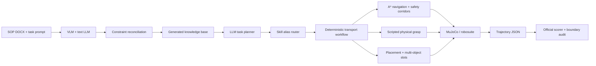

# JCIIOT 2026 — Industrial Embodied AI / 工业具身智能

[](https://github.com/zdhlll/jciiot/actions/workflows/portfolio-verify.yml)


[中文简介](#中文简介) · [English overview](#english-overview) · [复现 / Reproduce](#复现--reproduce) · [证据 / Evidence](#结果与证据--results-and-evidence)

## 中文简介

### 30 秒了解项目

这是 JCIIOT 2026 工业具身智能挑战赛的团队最终提交。系统面向 Tiago 移动双臂机器人，在 MuJoCo / robosuite 工厂分拣环境中完成“理解 SOP → 规划 → 导航 → 抓取 → 搬运 → 放置”的闭环任务。

最终提交在 L1–L5 五个关卡中取得 **100/100**，官方轨迹评分未产生碰撞扣分。项目的重点不是训练新的网络，而是把大模型规划的不确定性收敛到一条可审计、可复现的确定性物理执行链路。

### 核心工程亮点

- **文档到执行**：VLM 解析图示，文本 LLM 提取任务语义，再与锁定任务配置、语义地图和场景对象进行硬约束对账。
- **计划灵活、执行确定**：多个 LLM 技能名称在技能库层路由到同一条幂等搬运工作流，不修改官方 Agent 核心。
- **零 BC 模型抓取**：使用阶段表、闭环收敛与姿态锁定完成脚本化物理抓取，不依赖团队 checkpoint。
- **携物安全规划**：A*、最近可达回退、货架离场走廊、携物扫掠预检和多物体放置槽位共同约束导航。
- **证据优先**：提交包含五关逐帧轨迹、评分结果、复现文档和可执行边界审计。

## English overview

### In 30 seconds

This repository contains the team's final submission for the JCIIOT 2026 Industrial Embodied AI Challenge. A Tiago mobile manipulator executes the complete loop from SOP understanding and task planning to navigation, grasping, transport, and placement in MuJoCo / robosuite factory-sorting environments.

The final submission scored **100/100 across all five levels** with no collision penalty in the official trajectory-based scorer. Rather than proposing a new neural architecture, the project focuses on a deterministic, auditable execution layer that constrains uncertain LLM plans with simulator geometry, task configuration, and safety checks.

### Engineering highlights

- **Document-to-action pipeline:** VLM and text-LLM outputs are reconciled against locked task configuration, semantic maps, and simulator object identifiers.
- **Flexible plans, deterministic execution:** LLM-generated skill names converge on one idempotent, audited transport workflow without modifying the official Agent core.
- **Checkpoint-free grasping:** Scripted phases, bounded convergence, posture locking, and physical simulation replace a team-trained behavior-cloning checkpoint.
- **Payload-aware safety:** A* routing, reachable-point fallback, shelf-exit corridors, swept-volume checks, and placement slots account for the carried object's footprint.
- **Evidence-first delivery:** Every score is backed by trajectory, result, and scorer output files plus an executable protected-boundary audit.

## 系统架构 / Architecture




## 结果与证据 / Results and evidence

下表的运行时间来自各关 `result.json` 的执行时间；`score.json` 另包含约 3 秒的关闭与计分开销。

Execution time below comes from each level's `result.json`; `score.json` additionally includes roughly three seconds of shutdown and scoring overhead.

| Level | Environment | Score | Execution time | Frames | Evidence |
| --- | --- | ---: | ---: | ---: | --- |
| L1 | FactorySorting1 | 10/10 | 67.7 s | 480 | [L1](./JCIIOT/team_submission/evidence/L1/) |
| L2 | FactorySorting3 | 15/15 | 67.7 s | 463 | [L2](./JCIIOT/team_submission/evidence/L2/) |
| L3 | FactorySorting5 | 20/20 | 68.2 s | 508 | [L3](./JCIIOT/team_submission/evidence/L3/) |
| L4 | FactorySorting7 | 25/25 | 103.3 s | 701 | [L4](./JCIIOT/team_submission/evidence/L4/) |
| L5 | FactorySorting9 | 30/30 | 241.2 s | 1,579 | [L5](./JCIIOT/team_submission/evidence/L5/) |
| **Total** |  | **100/100** | **548.1 s** | **3,731** | [Audit](./JCIIOT/team_submission/audits/official_boundary_audit.md) |

## 仓库工程贡献 / Repository engineering contributions

这是一个多人团队项目，Git 历史保留了各作者的提交归属。以下内容描述仓库级团队成果，不应被解释为任一成员独立完成全部工作。

This is a team project and the Git history preserves per-author attribution. The items below describe repository-level team deliverables and should not be read as a claim that one contributor implemented everything.

- SOP 文档自动生成与三重约束对账 / SOP compilation with configuration and geometry reconciliation.
- 技能别名路由、幂等执行与确定性搬运编排 / Skill aliasing, idempotence, and deterministic transport orchestration.
- A* 导航、安全通道、转向合并与携物风险检查 / A* navigation, safety corridors, merged turning, and payload-risk checks.
- 脚本化抓取、融合回缩和多物体物理放置 / Scripted grasping, fused retraction, and multi-object physical placement.
- 五关证据归档与官方受保护边界自动审计 / Evidence packaging and automated protected-boundary verification.

## 复现 / Reproduce

### 1. 快速验证提交证据 / Verify the submitted evidence

该检查只使用 Python 标准库，不启动 MuJoCo，也不调用模型服务：

```bash
python JCIIOT/team_submission/audits/verify_final_submission.py --check-only
```

预期结果 / Expected result:

```text
Final submission verification: PASSED
Full-score evidence: 5/5 | Total: 100/100 | Boundary: clean
```

### 2. 文档与证据审阅模式 / Documentation-only clone

竞赛仓库包含大型 LFS 资产，且上游部分 LFS 对象当前可能不可用。只审阅代码历史、文档和提交证据时，可以跳过 LFS：

```bash
GIT_LFS_SKIP_SMUDGE=1 git clone --filter=blob:none --sparse https://github.com/zdhlll/jciiot.git
cd jciiot
git sparse-checkout set JCIIOT/team_submission JCIIOT/src/robot_agent/skills JCIIOT/sop_autogen_tool
```

### 3. 完整仿真 / Full simulation

完整复现需要 Linux、Python 3.11、Git LFS、官方竞赛资产，以及可用的文本 LLM / VLM 服务。安装和运行步骤见[复现指南](./复现指南.md)。若远端 LFS 对象缺失，需要从赛事方提供的原始资产恢复后再运行。

Full simulation requires Linux, Python 3.11, Git LFS, the original competition assets, and available text-LLM / VLM services. See the [reproduction guide](./复现指南.md). Missing upstream LFS objects must be restored from the organizer-provided assets.

## 文档索引 / Documentation

| Document | Purpose |
| --- | --- |
| [技术报告.md](./技术报告.md) | Architecture, implementation, results, compliance, and limitations |
| [新颖性声明.md](./新颖性声明.md) | Novelty claims with quantitative evidence |
| [复现指南.md](./复现指南.md) | Environment, installation, execution, and validation |
| [提交合规说明.md](./提交合规说明.md) | Rule-by-rule compliance and protected-boundary audit |

## 局限 / Limitations

- 几何策略针对竞赛五个 FactorySorting 场景设计，尚未证明跨工厂布局泛化。
- 抓取阶段步数和导航间距经过实验标定，尚未进行大规模随机化鲁棒性评测。
- 完整运行依赖竞赛资产与模型服务；仓库中的轻量审计只能验证已提交证据和代码边界，不能替代仿真复跑。
- This repository demonstrates competition-specific engineering, not a new foundation model or a general-purpose robotics policy.

## 技术栈 / Stack

Python 3.11 · MuJoCo · robosuite · NumPy · Streamlit · LLM/VLM planning · A* · trajectory-based evaluation

